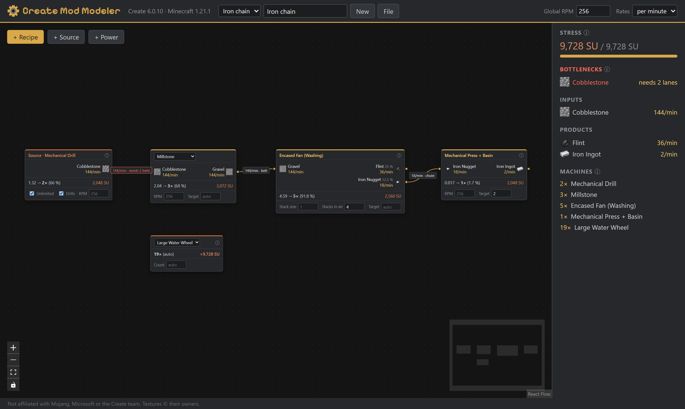
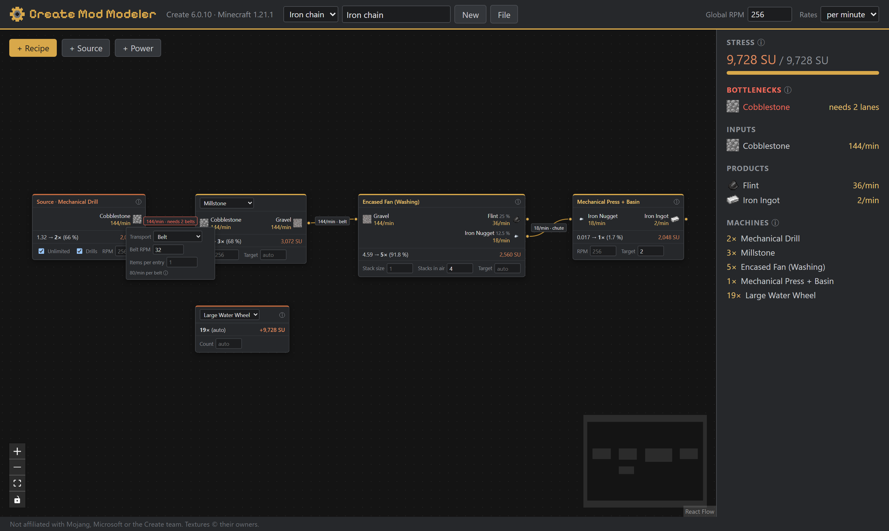

# Create Mod Modeler

A node-based production planner for the Minecraft mod [Create](https://github.com/Creators-of-Create/Create), inspired by the Satisfactory Modeler. Wire recipes into production chains and see item rates, machine counts and stress (SU) usage — calculated from the formulas in Create's source code.

**Live:** https://patrykput.github.io/create-mod-modeler/

Targets Create 6.0.10 on Minecraft 1.21.1 (NeoForge). See [docs/IMPLEMENTATION.md](docs/IMPLEMENTATION.md) for the roadmap and [docs/DESIGN.md](docs/DESIGN.md) for the design and mechanics reference.



## Features

- **Recipe nodes** for all Create processing types plus vanilla smelting and crafting, with machine counts, utilisation and stress per node; RPM, stack size and targets per node
- **Sources** with an optional rate; cobblestone and basalt show the Mechanical Drills they need
- **One solver for the whole graph**: chance outputs as averages, cycles, surplus and shortage instead of errors
- **Heat and fuel**: Blaze Burners per basin and their fuel as a wireable input
- **Transport** per edge: belt, chute or pipe with its limit and the lanes needed when it is exceeded
- **Power**: water wheels, windmills, hand cranks, creative motors and steam engines (with boiler level and pumps) against the plan's stress
- **Plans**: several named plans saved in the browser, JSON export/import, share links with the plan in the URL, summary as CSV



Every formula is ported from Create's source code and cites its file. Where the modeler has to assume something (an optimised cobblestone generator, belt hand-off delays, the mechanical crafter grid), the ⓘ next to it says so.

## Development

```bash
npm install
npm run dev        # dev server
npm test           # unit tests (Vitest)
npm run e2e        # Playwright smoke test against the production build
npm run screenshots # regenerate the README screenshots
npm run lint       # oxlint
npm run typecheck  # tsc
npm run build      # production build into dist/
npm run data       # regenerate src/data/*.json and public/textures/ from the Create and vanilla sources
```

Textures in `public/textures/` belong to the Create team and Mojang (see its `NOTICE.md`); they are not covered by this project's license.

## License

MIT — see [LICENSE](LICENSE).

Not affiliated with Mojang, Microsoft or the Create team.
